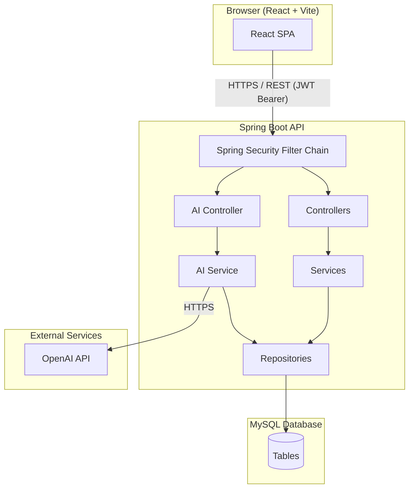
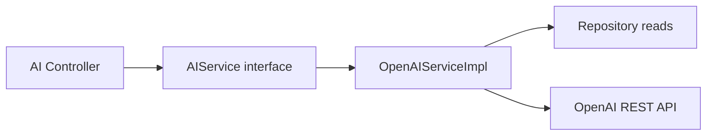
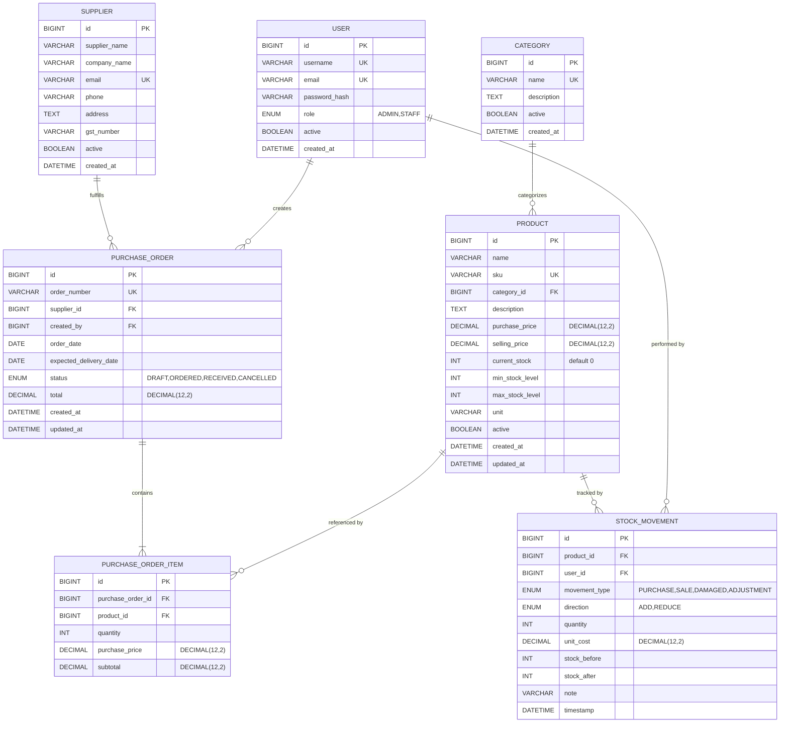
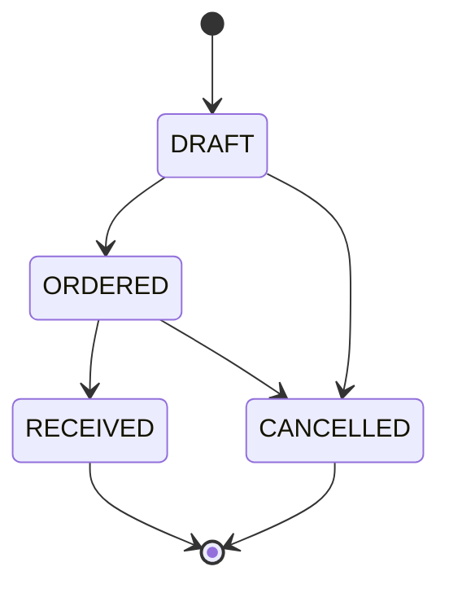

# Design Document

## Smart Inventory & Purchase Management System

---

## Overview

The Smart Inventory & Purchase Management System is a production-style full-stack web application for small and medium-sized businesses. It provides a complete workflow for managing product catalogs, supplier relationships, purchase orders, inventory stock movements, low-stock alerting, analytics dashboards, business reports, and AI-powered inventory recommendations.

The system is built as a decoupled three-tier application:

- **Frontend**: React.js (Vite) single-page application using JSX, Tailwind CSS, React Router, Axios, Lucide React icons, and Recharts for data visualization.
- **Backend**: Java Spring Boot REST API secured with JWT (Spring Security), using Spring Data JPA / Hibernate over a MySQL database.
- **AI Module**: An isolated backend service that integrates with the OpenAI Chat Completions API to answer natural-language inventory queries.

Two user roles govern access: **ADMIN** (full system access including all administrative operations) and **STAFF** (operational access — creating products, purchase orders, and stock movements, plus read-only access to all other data).

All business state is persisted in MySQL. The backend exposes a stateless, versioned REST API consumed by the React frontend over HTTPS. Every sensitive configuration value — database credentials, JWT secret, OpenAI key, frontend CORS origin — is supplied through environment variables and never appears in source code.

---

## Architecture

### High-Level Architecture



### Frontend JWT Storage Policy

The frontend enforces a strict in-memory-only JWT storage policy:

- The JWT is stored as React state inside `AuthContext` and exists only for the lifetime of the browser session (lost on page refresh or tab close). This is intentional — it eliminates the risk of XSS token theft from persistent browser storage.
- The JWT MUST NOT be written to `localStorage`, `sessionStorage`, cookies (including `document.cookie`), or `IndexedDB`.
- On login, the JWT is placed directly into `AuthContext` state and never touches persistent storage.
- On logout, `AuthContext.logout()` clears the in-memory JWT and redirects to the login page; no storage-clearing step is needed because nothing was persisted.
- Axios attaches the JWT as `Authorization: Bearer <token>` via a global request interceptor that reads from `AuthContext` at call time. If `AuthContext` holds no token, the interceptor omits the header, causing the backend to return HTTP 401.
- A 401 response from the backend triggers the Axios response interceptor to call `AuthContext.logout()` and redirect to the login page, clearing the in-memory token.

### Request Flow

1. The React SPA stores the JWT exclusively in memory via React state held in `AuthContext` — it is never written to `localStorage`, `sessionStorage`, or any other browser-persistent storage. On every authenticated HTTP request, an Axios request interceptor reads the JWT from `AuthContext` and attaches it as the `Authorization: Bearer <jwt>` header.
2. Spring Security's JWT filter validates the token signature and expiry before any controller method executes.
3. Method-level `@PreAuthorize` annotations (or Security configuration rules) enforce role checks; unauthorized requests return 403 before reaching service code.
4. Service methods annotated with `@Transactional` execute business logic and delegate to Spring Data JPA repositories.
5. All responses — success and error — are wrapped in a uniform envelope DTO before serialization.

### Package Structure (Backend)

```
com.inventory
├── config/          # SecurityConfig, CorsConfig, OpenApiConfig
├── controller/      # REST controllers (one per domain)
├── service/         # Business logic (interfaces + implementations)
├── repository/      # Spring Data JPA interfaces
├── entity/          # JPA entity classes
├── dto/             # Request DTOs, Response DTOs, Envelope DTOs
├── exception/       # Custom exceptions, GlobalExceptionHandler
├── security/        # JwtFilter, JwtService, UserDetailsServiceImpl
└── ai/              # AIController, AIService, AIServiceImpl, prompt builders
```

### Frontend Structure

```
src/
├── api/             # Axios instance + per-domain API modules
├── components/      # Shared UI components (Table, Modal, Toast, etc.)
├── contexts/        # AuthContext (JWT, user role, login/logout)
├── hooks/           # useAuth, usePagination, useToast
├── layouts/         # AppLayout (sidebar + outlet), AuthLayout
├── pages/           # One directory per domain feature
│   ├── auth/
│   ├── dashboard/
│   ├── products/
│   ├── categories/
│   ├── suppliers/
│   ├── purchase-orders/
│   ├── stock-movements/
│   ├── reports/
│   └── ai-assistant/
├── routes/          # Route definitions + ProtectedRoute, RoleRoute guards
└── utils/           # formatCurrency, formatDate, etc.
```

---

## Components and Interfaces

### Backend REST API

All successful responses use the envelope:
```json
{
  "success": true,
  "statusCode": 200,
  "message": "OK",
  "data": { ... }
}
```

All error responses use the envelope:
```json
{
  "success": false,
  "statusCode": 400,
  "message": "Validation failed",
  "timestamp": "2025-01-01T00:00:00Z"
}
```

Validation errors additionally include a `fieldErrors` map: `{ "fieldName": "violation message" }`.

#### Authentication Controller — `/api/v1/auth`

| Method | Path | Auth | Role | Description |
|--------|------|------|------|-------------|
| POST | `/register` | None | — | Register new STAFF account |
| POST | `/login` | None | — | Authenticate, receive JWT |

#### User Management Controller — `/api/v1/users`

| Method | Path | Auth | Role | Description |
|--------|------|------|------|-------------|
| POST | `/` | JWT | ADMIN | Create ADMIN or STAFF account |
| GET | `/` | JWT | ADMIN | List users (paginated) |

#### Product Controller — `/api/v1/products`

| Method | Path | Auth | Role | Description |
|--------|------|------|------|-------------|
| POST | `/` | JWT | ADMIN, STAFF | Create product |
| GET | `/` | JWT | ADMIN, STAFF | Paginated list (search/filter/sort) |
| GET | `/{id}` | JWT | ADMIN, STAFF | Get product by ID |
| PUT | `/{id}` | JWT | ADMIN, STAFF | Update product |
| PATCH | `/{id}/deactivate` | JWT | ADMIN | Deactivate product |

#### Category Controller — `/api/v1/categories`

| Method | Path | Auth | Role | Description |
|--------|------|------|------|-------------|
| POST | `/` | JWT | ADMIN | Create category |
| GET | `/` | JWT | ADMIN, STAFF | List all categories |
| PUT | `/{id}` | JWT | ADMIN | Update category |
| PATCH | `/{id}/deactivate` | JWT | ADMIN | Deactivate category |
| GET | `/{id}/products` | JWT | ADMIN, STAFF | Products by category (paginated) |

#### Supplier Controller — `/api/v1/suppliers`

| Method | Path | Auth | Role | Description |
|--------|------|------|------|-------------|
| POST | `/` | JWT | ADMIN | Create supplier |
| GET | `/` | JWT | ADMIN, STAFF | Paginated list |
| GET | `/{id}` | JWT | ADMIN, STAFF | Get supplier by ID |
| PUT | `/{id}` | JWT | ADMIN | Update supplier |
| PATCH | `/{id}/deactivate` | JWT | ADMIN | Deactivate supplier |

#### Purchase Order Controller — `/api/v1/purchase-orders`

| Method | Path | Auth | Role | Description |
|--------|------|------|------|-------------|
| POST | `/` | JWT | ADMIN, STAFF | Create purchase order (DRAFT) |
| GET | `/` | JWT | ADMIN, STAFF | Paginated list (filter/sort) |
| GET | `/{id}` | JWT | ADMIN, STAFF | Get order by ID |
| PATCH | `/{id}/status` | JWT | ADMIN, STAFF | Update order status |
| GET | `/{id}/items` | JWT | ADMIN, STAFF | Get order line items |

#### Stock Movement Controller — `/api/v1/stock-movements`

| Method | Path | Auth | Role | Description |
|--------|------|------|------|-------------|
| POST | `/` | JWT | ADMIN, STAFF | Record stock movement |
| GET | `/` | JWT | ADMIN, STAFF | Paginated list (filter/sort) |

#### Low Stock Controller — `/api/v1/low-stock`

| Method | Path | Auth | Role | Description |
|--------|------|------|------|-------------|
| GET | `/` | JWT | ADMIN, STAFF | Low/out-of-stock list (filterable) |
| GET | `/out-of-stock` | JWT | ADMIN, STAFF | Out-of-stock only |
| GET | `/summary` | JWT | ADMIN, STAFF | Summary + top-10 critical |

#### Dashboard Controller — `/api/v1/dashboard`

| Method | Path | Auth | Role | Description |
|--------|------|------|------|-------------|
| GET | `/summary` | JWT | ADMIN, STAFF | KPI metrics |
| GET | `/recent-movements` | JWT | ADMIN, STAFF | Last 10 movements |
| GET | `/purchase-trend` | JWT | ADMIN, STAFF | Daily PO totals in range |
| GET | `/inventory-trend` | JWT | ADMIN, STAFF | Cumulative daily inventory value |

#### Report Controller — `/api/v1/reports`

| Method | Path | Auth | Role | Description |
|--------|------|------|------|-------------|
| GET | `/purchase` | JWT | ADMIN, STAFF | Purchase report by date range |
| GET | `/inventory` | JWT | ADMIN, STAFF | Inventory report by date range |
| GET | `/supplier-purchase` | JWT | ADMIN, STAFF | Supplier PO report |
| GET | `/stock-movements` | JWT | ADMIN, STAFF | Stock movement report |
| GET | `/low-stock` | JWT | ADMIN, STAFF | Low-stock report with reorder qty |

#### AI Controller — `/api/v1/ai`

| Method | Path | Auth | Role | Description |
|--------|------|------|------|-------------|
| POST | `/query` | JWT | ADMIN, STAFF | Natural-language inventory query |

---

### Key Service Interfaces

```java
// AuthService
UserResponseDTO register(RegisterRequestDTO req);
LoginResponseDTO login(LoginRequestDTO req);

// ProductService
ProductResponseDTO createProduct(CreateProductRequestDTO req);
ProductResponseDTO updateProduct(Long id, UpdateProductRequestDTO req);
ProductResponseDTO deactivateProduct(Long id);
Page<ProductResponseDTO> getProducts(ProductFilterParams params, Pageable pageable);
ProductResponseDTO getProductById(Long id);

// PurchaseOrderService
PurchaseOrderResponseDTO createOrder(CreatePurchaseOrderRequestDTO req);
PurchaseOrderResponseDTO updateStatus(Long id, UpdateStatusRequestDTO req, User actingUser);

// StockMovementService
StockMovementResponseDTO recordMovement(CreateMovementRequestDTO req, User actingUser);
Page<StockMovementResponseDTO> getMovements(MovementFilterParams params, Pageable pageable);

// DashboardService
DashboardSummaryDTO getSummary();
List<PurchaseTrendPointDTO> getPurchaseTrend(LocalDate start, LocalDate end);
List<InventoryTrendPointDTO> getInventoryTrend(LocalDate start, LocalDate end);

// AIService (interface — swappable)
String query(AIQueryRequestDTO req);
```

### JWT Service

- `generateToken(UserDetails user)` — creates signed HS256 JWT with role claim and configurable expiry
- `validateToken(String token, UserDetails user)` — verifies signature, expiry, and username match
- `extractUsername(String token)` — parses subject claim

### AI Service Design

The AI module is intentionally isolated:



`AIServiceImpl` builds a context prompt from live database queries (product counts, low-stock items, recent movements, etc.) and appends the user's natural-language question. The OpenAI API is called with a 30-second HTTP timeout. If the call fails or times out, the service throws an `AIServiceUnavailableException` which the global handler maps to HTTP 503. Replacing the provider requires implementing only `AIService` and rebinding the bean in configuration.

---

## Data Models

### Entity Relationship Diagram



### Key Entity Notes

**Product**
- `current_stock` is only modified via the `StockMovementService` transaction or the `PurchaseOrderService` RECEIVED transition — never patched directly.
- Soft-deleted via `active = false`; no hard deletes anywhere in the system.

**Purchase Order — Order Number Generation**
- Format: `PO-YYYYMMDD-NNNNNN` where `NNNNNN` is a zero-padded 6-digit sequence number that is unique per calendar day, obtained by atomically incrementing a per-day counter. The counter MUST be incremented inside the same database transaction as the PurchaseOrder insert, using either a dedicated `purchase_order_sequence` table with a `SELECT ... FOR UPDATE` row lock per date, or a database sequence/auto-increment mechanism scoped per day, so that concurrent PO creation never produces duplicate order numbers.
- Generated in `PurchaseOrderService.createOrder()` atomically within the same transaction that inserts the PurchaseOrder; the `order_number` column carries a UNIQUE constraint as a safety net, but the primary guarantee of uniqueness under concurrent load comes from the row-level lock on the per-day sequence counter.

**Purchase Order — Status Transition Machine**



Any transition not shown above returns HTTP 400.

**Stock Movement — Immutability**
- No `UPDATE` or `DELETE` endpoint is exposed.
- `direction` is derived from `movement_type` except for `ADJUSTMENT`, which requires an explicit `direction` field in the request.

**RECEIVED Transition — Transactional Stock Update**

```
@Transactional
for each PurchaseOrderItem item:
    product = lock product row (SELECT FOR UPDATE)
    stockBefore = product.currentStock
    stockAfter  = stockBefore + item.quantity
    create StockMovement(
        type=PURCHASE, direction=ADD,
        quantity=item.quantity, unitCost=item.purchasePrice,
        stockBefore, stockAfter, note=order.orderNumber,
        timestamp=UTC now, actingUser=caller
    )
    product.currentStock = stockAfter
order.status = RECEIVED
```

If any step throws, the transaction rolls back entirely.

**Low Stock — Criticality Sorting (Summary Endpoint)**

Top-10 critical products are ordered by:
1. Products with `min_stock_level > 0` sorted by `(current_stock / min_stock_level)` ascending (lower ratio = more critical).
2. Products with `min_stock_level = 0` (ratio treated as 0) appended, sorted by `product name` ascending.
3. Ties in ratio broken by `product name` ascending.

This can be implemented as a single JPQL query using a `CASE` expression for the ratio.

**Inventory Trend Calculation**

The `getInventoryTrend(start, end)` algorithm:

1. **Opening value**: `SUM(quantity × unit_cost)` over all `StockMovement` rows with `timestamp < start`, where ADD movements are positive and REDUCE movements are negative.
2. **Daily deltas**: For each day D in `[start, end]` (inclusive), compute `SUM(signed quantity × unit_cost)` for movements on day D.
3. **Cumulative output**: Carry the running total forward, emitting one `{ date, inventoryValue }` entry per day.

---

## Correctness Properties

*A property is a characteristic or behavior that should hold true across all valid executions of a system — essentially, a formal statement about what the system should do. Properties serve as the bridge between human-readable specifications and machine-verifiable correctness guarantees.*

---

### Property 1: Registration always assigns STAFF role

*For any* valid registration request payload — regardless of what role value (ADMIN, STAFF, or any arbitrary string) is supplied in the request body — the created User account SHALL have the STAFF role.

**Validates: Requirements 1.1**

---

### Property 2: Invalid passwords are always rejected

*For any* password string that fails at least one complexity rule (fewer than 8 characters, no uppercase letter, no lowercase letter, or no digit), the registration endpoint SHALL return HTTP 400 and SHALL NOT create a User record.

**Validates: Requirements 1.3**

---

### Property 3: API responses never expose passwords

*For any* API response from any endpoint, the serialized JSON body SHALL NOT contain a field named `password`, `passwordHash`, or `password_hash`.

**Validates: Requirements 1.13, 15.5**

---

### Property 4: New products always start with zero stock

*For any* valid create-product request, the Product returned in the response DTO SHALL have `currentStock = 0`, regardless of any other field values in the request.

**Validates: Requirements 3.1**

---

### Property 5: Invalid stock level ranges are rejected

*For any* create-product or update-product request where `minStockLevel > maxStockLevel`, the API SHALL return HTTP 400 and SHALL NOT persist a Product record.

**Validates: Requirements 3.10, 3.11**

---

### Property 6: Paginated responses satisfy metadata invariants

*For any* paginated API response with page size `S`, page number `P`, and total elements `T`:

- `totalPages = ceil(T / S)` when T > 0; `totalPages = 0` when T = 0
- The number of items in `data` is at most `S`
- `first = (P == 0)`, `last = (P == totalPages - 1)`
- When `T = 0`, `totalPages = 0`, `data` is empty, and all other metadata fields reflect zero; when `P >= totalPages` and `T > 0`, `data` is empty and metadata still reflects accurate totals

**Validates: Requirements 13.1, 13.2, 13.6**

---

### Property 7: Purchase order totals are arithmetically correct

*For any* valid create-purchase-order request with N line items where item `i` has `quantity_i` and `purchasePrice_i`:

- `subtotal_i = quantity_i × purchasePrice_i` for every item
- `total = Σ subtotal_i` across all items

These invariants hold for any combination of quantities and prices within their valid ranges.

**Validates: Requirements 6.1**

---

### Property 8: Purchase order status machine is correctly enforced

*For any* Purchase Order in status `S` and any requested target status `T`:

- The transition is accepted (HTTP 200) if and only if `(S, T)` is one of: `(DRAFT, ORDERED)`, `(DRAFT, CANCELLED)`, `(ORDERED, RECEIVED)`, `(ORDERED, CANCELLED)`
- All other transitions (including any transition from `RECEIVED` or `CANCELLED`) return HTTP 400

**Validates: Requirements 6.6, 6.7, 6.11**

---

### Property 9: RECEIVED transition correctly updates stock and creates movements

*For any* Purchase Order with N items transitioning to `RECEIVED`, where item `i` references product `p_i` with pre-transition stock `s_i`:

- Each product `p_i`'s `currentStock` increases by `item_i.quantity` (i.e., becomes `s_i + item_i.quantity`)
- Exactly one `StockMovement` record is created per item with: `movementType = PURCHASE`, `direction = ADD`, `quantity = item_i.quantity`, `unitCost = item_i.purchasePrice`, `stockBefore = s_i`, `stockAfter = s_i + item_i.quantity`, `note = orderNumber`
- If any step fails, all stock updates and movement inserts are rolled back atomically

**Validates: Requirements 6.8, 6.9**

---

### Property 10: Stock movement delta and audit fields are consistent

*For any* successfully recorded stock movement on a product with pre-movement stock `S`, signed delta `D` (positive for ADD-direction movements, negative for REDUCE-direction movements):

- `stockBefore = S`
- `stockAfter = S + D`
- `direction = ADD` for `movementType ∈ {PURCHASE, ADJUSTMENT ADD}`
- `direction = REDUCE` for `movementType ∈ {SALE, DAMAGED, ADJUSTMENT REDUCE}`
- `unitCost = product.purchasePrice` at the time the movement is recorded

**Validates: Requirements 7.1, 7.7**

---

### Property 11: Stock cannot be driven below zero

*For any* stock movement request on a product with current stock `S` where the computed `stockAfter` would be negative (`S + D < 0`), the API SHALL return HTTP 400 and SHALL NOT modify the product's stock or create any movement record.

**Validates: Requirements 7.2, 7.3**

---

### Property 12: Stock movement quantity bounds are enforced

*For any* stock movement request with a quantity `Q` where `Q ≤ 0` or `Q > 1,000,000`, the API SHALL return HTTP 400 and SHALL NOT persist any changes.

**Validates: Requirements 7.8**

---

### Property 13: Low-stock classification matches the definition

*For any* active Product with `currentStock = C` and `minStockLevel = M`:

- If `C = 0`: the product appears in the out-of-stock list and carries status `OUT_OF_STOCK`
- If `C > 0` and `C ≤ M`: the product appears in the low-stock list and carries status `LOW_STOCK`
- If `C > M`: the product does NOT appear in either list

**Validates: Requirements 8.1, 8.2, 8.3, 8.4, 8.6, 8.7**

---

### Property 14: Low-stock summary top-10 sort is correctly ordered

*For any* set of active low-stock or out-of-stock products, the top-10 critical product list returned by the summary endpoint SHALL be ordered as follows:

1. Products with `minStockLevel > 0` sorted by `currentStock / minStockLevel` ascending (smaller ratio first)
2. Products with `minStockLevel = 0` come after all ratio-ranked products, sorted by product name ascending
3. Ties in ratio are broken by product name ascending

**Validates: Requirements 8.5**

---

### Property 15: Inventory trend value is a correct cumulative sum

*For any* set of Stock_Movement records and a requested date range `[start, end]`:

- `openingValue = Σ (signed(qty × unitCost))` for all movements with `timestamp < start` (ADD positive, REDUCE negative)
- For each day `D` in `[start, end]`: `dailyValue(D) = openingValue + Σ (signed(qty × unitCost))` for all movements with `timestamp ≤ D`
- The response contains exactly one entry per calendar day in the range

**Validates: Requirements 9.4**

---

### Property 16: Low-stock report reorder quantity is correct

*For any* product appearing in the low-stock report with `currentStock = C` and `maxStockLevel = X`:

- `recommendedReorderQuantity = X - C`

This holds for any combination of valid `C` and `X` values where `C ≤ X`.

**Validates: Requirements 10.5**

---

### Property 17: Report endpoints reject inverted date ranges

*For any* report request to any report endpoint where `startDate > endDate`, the API SHALL return HTTP 400.

**Validates: Requirements 10.6**

---

### Property 18: All API responses conform to the envelope structure

*For any* API call to any endpoint, the JSON response body SHALL contain exactly the required envelope fields:

- Success responses: `success = true`, `statusCode`, `message`, `data`
- Error responses: `success = false`, `statusCode`, `message`, `timestamp`
- Validation error responses additionally include a `fieldErrors` map

No envelope field is ever absent, null (for required fields), or of the wrong type.

**Validates: Requirements 12.1, 12.2, 12.3**

---

### Property 19: Search results are always consistent with the search query

*For any* search query string `Q` applied to a searchable list endpoint, every item in the result set SHALL have its designated search field contain `Q` as a substring (case-insensitive). No item in the result set SHALL be absent from the full dataset.

**Validates: Requirements 13.3**

---

### Property 20: Monetary values survive a storage round-trip without precision loss

*For any* monetary amount `V` with at most 2 decimal places and absolute value at most 999,999,999.99, storing `V` and retrieving it via the API SHALL return a value numerically equal to `V`.

**Validates: Requirements 18.3**

---

## Error Handling

### Global Exception Handler

A `@ControllerAdvice` `GlobalExceptionHandler` intercepts all uncaught exceptions before they reach the servlet layer. It maps exception types to HTTP responses and always wraps the result in the error envelope DTO. Stack traces are never serialized into responses.

| Exception | HTTP Status | Notes |
|-----------|-------------|-------|
| `ResourceNotFoundException` | 404 | Includes resource type and ID |
| `DuplicateResourceException` | 409 | Includes field name |
| `InvalidStatusTransitionException` | 400 | Describes the invalid transition |
| `InsufficientStockException` | 400 | States resulting negative stock |
| `InvalidDateRangeException` | 400 | Reports which dates are invalid |
| `AIServiceUnavailableException` | 503 | Generic "AI service temporarily unavailable" |
| `MethodArgumentNotValidException` | 400 | Bean Validation failures — includes `fieldErrors` map |
| `ConstraintViolationException` | 400 | JPA constraint violations |
| `HttpRequestMethodNotSupportedException` | 405 | Unsupported HTTP method |
| `AccessDeniedException` | 403 | Spring Security — includes required role |
| `AuthenticationException` | 401 | Spring Security — expired/malformed/missing JWT |
| Any other `Exception` | 500 | Generic message, no internals exposed |

### Transactional Boundaries

All service methods that mutate state are annotated `@Transactional`. Critical multi-step operations use explicit locking:

- **PO RECEIVED transition**: Each product row is locked with `SELECT FOR UPDATE` before stock modification. If any item fails (e.g., concurrent modification), the entire transaction rolls back.
- **Manual stock movements**: The product row is read and locked within the same transaction to prevent race conditions.

### Validation Strategy

- **Request-level**: Bean Validation (`@Valid`, `@NotNull`, `@Min`, `@Pattern`, etc.) on all DTO fields. Violations are collected and returned as a `fieldErrors` map before service logic runs.
- **Business-level**: Service layer validates cross-field rules (min > max stock, invalid PO status transition, negative stock result) and throws typed exceptions.
- **Persistence-level**: Unique constraints in the database serve as the final safety net for concurrent duplicate inserts.

### AI Module Error Isolation

The AI service wraps all OpenAI API calls in a try-catch. Network timeouts use a `RestTemplate` with a 30-second read timeout configured in `AIConfig`. Any exception from the HTTP call is caught and rethrown as `AIServiceUnavailableException`. The raw OpenAI error message is logged server-side but never included in the API response.

---

## Testing Strategy

### Approach

The system uses a dual-layer testing strategy:

1. **Unit / Property-based tests**: Verify business logic in isolation, covering the Service layer and pure utility functions. Property-based tests run 100+ iterations with generated inputs to validate universal properties.
2. **Integration tests**: Verify that the full request-response cycle works correctly end-to-end, including Spring Security filters, database persistence, and transactional behavior. These use `@SpringBootTest` with an in-memory H2 database or Testcontainers with MySQL.

### Property-Based Testing

PBT applies to this feature because the system contains significant pure business logic — stock calculations, PO arithmetic, status machine transitions, classification rules, and inventory trend computation — where universal properties hold across a wide input space.

**PBT Library**: [jqwik](https://jqwik.net/) (Java) — a property-based testing framework for JUnit 5.

**Configuration**: Each `@Property` test uses `@Property(tries = 100)` as the minimum iteration count. Tests that do not require external services run in-memory with mocked repositories.

**Tag format**: Each property test is annotated with a comment:
```
// Feature: smart-inventory-management, Property {N}: {property_text}
```

**Properties to implement as property-based tests** (one test per property):

| Property | Test class | Key generators |
|----------|------------|----------------|
| P1: Registration role enforcement | `AuthServicePropertyTest` | `Arbitraries.of(Role.values())`, random valid usernames/passwords |
| P2: Invalid password rejection | `AuthServicePropertyTest` | Strings that violate each complexity rule |
| P3: Responses never expose passwords | `ApiResponsePropertyTest` | Any user operation endpoint |
| P4: New products start with stock=0 | `ProductServicePropertyTest` | Random valid product creation requests |
| P5: Invalid stock range rejection | `ProductServicePropertyTest` | `(min, max)` pairs where `min > max` |
| P6: Pagination metadata invariants | `PaginationPropertyTest` | Random `(pageSize, pageNumber, totalElements)` triples |
| P7: PO total arithmetic | `PurchaseOrderServicePropertyTest` | Random item lists with quantities and prices |
| P8: PO status machine | `PurchaseOrderServicePropertyTest` | `Arbitraries.of(OrderStatus.values())` cross-product |
| P9: RECEIVED transaction correctness | `PurchaseOrderServicePropertyTest` | Random N-item orders; mocked repositories |
| P10: Movement delta consistency | `StockMovementServicePropertyTest` | Random stock levels, movement types, quantities |
| P11: Negative stock rejection | `StockMovementServicePropertyTest` | `quantity > currentStock` for REDUCE movements |
| P12: Movement quantity bounds | `StockMovementServicePropertyTest` | `quantity <= 0` or `quantity > 1_000_000` |
| P13: Low-stock classification | `LowStockServicePropertyTest` | Random `(currentStock, minStockLevel)` pairs |
| P14: Summary sort order | `LowStockServicePropertyTest` | Random product sets with varying stock/min levels |
| P15: Inventory trend cumulative sum | `DashboardServicePropertyTest` | Random movement lists with timestamps |
| P16: Reorder quantity formula | `ReportServicePropertyTest` | Random `(currentStock, maxStockLevel)` pairs |
| P17: Date range validation | `ReportServicePropertyTest` | `(start, end)` pairs where `start > end` |
| P18: Response envelope structure | `ApiResponsePropertyTest` | Any endpoint call |
| P19: Search result consistency | `SearchPropertyTest` | Random query strings against seeded datasets |
| P20: Monetary precision | `MonetaryPrecisionPropertyTest` | Random `DECIMAL(12,2)` values |

### Unit Tests

Unit tests focus on specific examples, edge cases, and integration points not covered by property tests:

- Authentication: BCrypt hash verification, JWT generation/validation/expiry
- Role-based access: STAFF calling ADMIN-only endpoints (403), unauthenticated requests (401)
- PO creation: inactive supplier (400), inactive product (400), duplicate product in items (400), past delivery date (400)
- ADJUSTMENT movement without direction field (400)
- AI service: mocked OpenAI success response, timeout → 503
- Global exception handler: each exception type mapped to correct status
- Response envelope: correct shape for success, error, and validation error cases
- Deactivation (soft-delete): record still exists after deactivation

### Integration Tests

Integration tests verify behavior that spans the full stack:

- Complete auth flow: register → login → access protected endpoint with JWT
- RECEIVED transition end-to-end: create PO → transition to ORDERED → transition to RECEIVED → verify stock increments and movements persisted in DB
- Manual stock movement end-to-end: record SALE → verify product stock decremented and movement created
- Concurrent stock modification: two simultaneous RECEIVED transitions on overlapping products — verify no double-counting due to row-level locking
- Dashboard KPIs match DB aggregates after known seeded data
- Inventory trend matches manual calculation over seeded movements
- AI query with mocked OpenAI HTTP call: verify prompt structure and response passthrough

### Frontend Testing

- **Unit tests** (Vitest + React Testing Library): form validation (field-level errors before submit), component rendering with loading/empty/error states, route guard redirects for unauthenticated and unauthorized users
- **Integration tests**: Axios interceptor attaches Bearer token; logout clears token and redirects
- **Visual**: Manual or snapshot tests for chart rendering (Recharts); responsive layout spot-checks at 375px and 1920px
